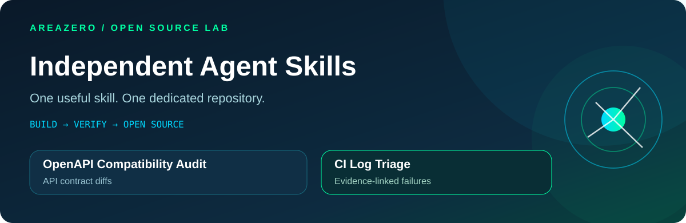
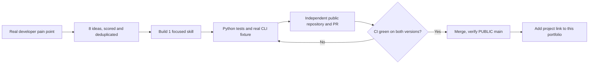

<p align="center"></p>

<p align="center"></p>

<h3 align="center">Make AI more useful every day — one tested open-source skill at a time.</h3>

<p align="center">An independent project for every Skill. A clear developer problem. Reproducible code and tests.<br>Built by <b>AREAZERO Skill Lab</b> for <b>Claude Code</b>, <b>Codex</b>, and open-source developers.</p>

<p align="center">
<a href="https://github.com/Kanompung1988/agent-skills/actions/workflows/validate-skills.yml"></a>
<a href="https://agentskills.io/specification"></a>

<a href="LICENSE"></a>
</p>

<p align="center"><a href="#explore-the-skills"><b>Explore skills</b></a> &nbsp;·&nbsp; <a href="#how-to-install"><b>Install</b></a> &nbsp;·&nbsp; <a href="#how-we-work"><b>Our process</b></a> &nbsp;·&nbsp; <a href="docs/EPISODES.md"><b>Episodes</b></a> &nbsp;·&nbsp; <a href="docs/SKILL_LAB_OPERATIONS.md"><b>Automation contract</b></a></p>

> [!NOTE]
> **This repository is the portfolio and release index, not a monorepo of skills.** Each skill is independently maintained in its own PUBLIC GitHub repository, with its own README, source, CI, issues, stars and contributor activity. Follow the individual repository links below to install or report bugs.

## Why independent repositories?

Most developer problems deserve a focused tool, not a giant feature list. Independent projects let you inspect a small codebase, install only what you need, and follow the issues/releases that matter to you. For maintainers, every repository has a distinct CI history and contribution scope; this page is simply the discovery layer.

## Explore the skills

<table>
<tr>
<td width="50%" valign="top">
<h3>01 · OpenAPI Compatibility Audit</h3>
<p><b>Catch likely API breaking changes before an SDK release.</b></p>
<p>Diff two local OpenAPI 3.x specs. Flags removed routes, newly required fields, narrowed input enums, missing successful responses and more. Explains every finding with a location and manual verification guidance.</p>
<p><a href="https://github.com/Kanompung1988/openapi-compat-audit"><b>Source, README & install →</b></a></p>
<p><a href="https://github.com/Kanompung1988/openapi-compat-audit/actions/workflows/ci.yml"></a></p>
</td>
<td width="50%" valign="top">
<h3>02 · CI Log Triage</h3>
<p><b>From a failed build to evidence instead of guesses.</b></p>
<p>Analyze a local build/CI log, group TypeScript, dependency and assertion failures, and return line-referenced evidence plus safe next checks. Regex confidence hints are not claimed as root-cause certainty.</p>
<p><a href="https://github.com/Kanompung1988/ci-log-triage"><b>Source, README & install →</b></a></p>
<p><a href="https://github.com/Kanompung1988/ci-log-triage/actions/workflows/ci.yml"></a></p>
</td>
</tr>
<tr>
<td width="50%" valign="top">
<h3>03 · GHA Trust Boundary Audit</h3>
<p><b>Line-level review of privileged GitHub Actions trust crossings.</b></p>
<p>Read-only inspection of pull_request_target checkout and execution, script interpolation from untrusted event values, token permissions and mutable actions. Includes conservative severity and remediation.</p>
<p><a href="https://github.com/Kanompung1988/gha-trust-boundary-audit"><b>Source, README & install →</b></a></p>
<p><a href="https://github.com/Kanompung1988/gha-trust-boundary-audit/actions/workflows/ci.yml"></a></p>
</td>
<td width="50%" valign="top">
<h3>04 · Env Contract Audit</h3>
<p><b>Find environment-variable documentation drift before deploy.</b></p>
<p>Offline names-only comparison of Python/Node/Vite references with .env.example; flags missing declarations and suspect public-bundle names without reading actual secrets.</p>
<p><a href="https://github.com/Kanompung1988/env-contract-audit"><b>Source, README & install →</b></a></p>
<p><a href="https://github.com/Kanompung1988/env-contract-audit/actions/workflows/ci.yml"></a></p>
</td>
</tr>
<tr>
<td width="50%" valign="top">
<h3>05 · PG Migration Risk Audit</h3>
<p><b>Find PostgreSQL migration lock and data-loss risks before deployment.</b></p>
<p>Offline, line-level review of SQL migrations for DROP, TRUNCATE, unbounded writes and concurrent index transaction issues. Reads files only; never executes SQL or connects to the database.</p>
<p><a href="https://github.com/Kanompung1988/pg-migration-risk-audit"><b>Source, README & install →</b></a></p>
<p><a href="https://github.com/Kanompung1988/pg-migration-risk-audit/actions/workflows/ci.yml"></a></p>
</td>
<td width="50%" valign="top">
<h3>06 · Docker Context Guard</h3>
<p><b>Review what Docker might send into a build context.</b></p>
<p>Read-only review of Dockerfile COPY/ADD, .dockerignore precedence, sensitive-looking filenames and ARG/ENV key names without reading secret values. The matcher is deliberately an approximation.</p>
<p><a href="https://github.com/Kanompung1988/docker-context-guard"><b>Source, README & install →</b></a></p>
<p><a href="https://github.com/Kanompung1988/docker-context-guard/actions/workflows/ci.yml"></a></p>
</td>
</tr>
<tr>
<td width="50%" valign="top">
<h3>07 · Python Artifact Audit</h3>
<p><b>Review the archive you actually ship to PyPI.</b></p>
<p>Inspect built wheels and source archives offline for path traversal-looking entries, sensitive-looking filenames, duplicate members and selected metadata defects. Does not extract or execute packages or inspect secret values.</p>
<p><a href="https://github.com/Kanompung1988/python-artifact-audit"><b>Source, README &amp; install →</b></a></p>
<p><a href="https://github.com/Kanompung1988/python-artifact-audit/actions/workflows/ci.yml"></a></p>
</td>
<td width="50%" valign="top">
<h3>08 · Kubernetes RBAC Rights Audit</h3>
<p><b>Make least-privilege changes reviewable before deployment.</b></p>
<p>Inspect Role/ClusterRole and bindings as local YAML/JSON; flag wildcard access, secrets list, escalation verbs, cluster-admin grants and risky identity bindings, with evidence and namespace scope.</p>
<p><a href="https://github.com/Kanompung1988/k8s-rbac-rights-audit"><b>Source, README &amp; install →</b></a></p>
<p><a href="https://github.com/Kanompung1988/k8s-rbac-rights-audit/actions/workflows/ci.yml"></a></p>
</td>
</tr>
<tr>
<td width="50%" valign="top">
<h3>09 · Terraform Plan Impact Audit</h3>
<p><b>Turn a saved Terraform plan into a values-blind change-risk report.</b></p>
<p>Read local `terraform show -json` plans and flag deletes, replacement ordering, root-output removal and drift without printing secret values. Intended for review, never a substitute for a deployment approval.</p>
<p><a href="https://github.com/Kanompung1988/terraform-plan-impact-audit"><b>Source, README &amp; install →</b></a></p>
<p><a href="https://github.com/Kanompung1988/terraform-plan-impact-audit/actions/workflows/ci.yml"></a></p>
</td>
<td width="50%" valign="top">
<h3>10 · Kubernetes NetworkPolicy Scope Audit</h3>
<p><b>Explain who a NetworkPolicy selector may allow before applying YAML.</b></p>
<p>Offline, read-only inspection of namespace/pod selector scopes, broad peers, CIDRs and ports. Explains combined selector semantics, not the full effective behavior of a CNI.</p>
<p><a href="https://github.com/Kanompung1988/k8s-netpol-scope-audit"><b>Source, README &amp; install →</b></a></p>
<p><a href="https://github.com/Kanompung1988/k8s-netpol-scope-audit/actions/workflows/ci.yml"></a></p>
</td>
</tr>

<tr>
<td width="50%" valign="top">
<h3>11 · CODEOWNERS Review Gap Audit</h3>
<p><b>Find ownership gaps before a critical file gets merged without intended reviewers.</b></p>
<p>Offline audit of documented CODEOWNERS pattern precedence, missing and ownerless matches for selected high-risk paths. Does not prove branch rules or actual reviewer permissions.</p>
<p><a href="https://github.com/Kanompung1988/codeowners-review-gap-audit"><b>Source, README &amp; install →</b></a></p>
<p><a href="https://github.com/Kanompung1988/codeowners-review-gap-audit/actions/workflows/ci.yml"></a></p>
</td>
<td width="50%" valign="top">
<h3>12 · Kubernetes Image Pin Audit</h3>
<p><b>Review mutable image references and pull policies before deployment.</b></p>
<p>Offline inspection of Kubernetes YAML for tag/digest syntax and imagePullPolicy combinations. It does not connect to registries or verify actual image integrity.</p>
<p><a href="https://github.com/Kanompung1988/k8s-image-pin-audit"><b>Source, README &amp; install →</b></a></p>
<p><a href="https://github.com/Kanompung1988/k8s-image-pin-audit/actions/workflows/ci.yml"></a></p>
</td>
</tr>
</table>

| Skill | CLI | Verified QA evidence | Repository |
|---|---|---|---|
| OpenAPI audit | Local JSON/YAML OpenAPI 3.x comparison | [Python 3.10/3.12 — 16 unit tests + 1 smoke each](https://github.com/Kanompung1988/openapi-compat-audit/actions/runs/40093092063) | [openapi-compat-audit](https://github.com/Kanompung1988/openapi-compat-audit) |
| CI log triage | Local text CI log classification | [Python 3.10/3.12 — 16 unit tests + 1 smoke each](https://github.com/Kanompung1988/ci-log-triage/actions/runs/40093094810) | [ci-log-triage](https://github.com/Kanompung1988/ci-log-triage) |
| GHA trust boundary | Local GitHub Actions YAML static review | [Python 3.10/3.12 — 23 unit tests + CLI smoke each](https://github.com/Kanompung1988/gha-trust-boundary-audit/actions/runs/40258709081) | [gha-trust-boundary-audit](https://github.com/Kanompung1988/gha-trust-boundary-audit) |
| Env contract | Offline code/example env-key name comparison | [Python 3.10/3.12 — 25 unit tests + CLI smoke each](https://github.com/Kanompung1988/env-contract-audit/actions/runs/40258713283) | [env-contract-audit](https://github.com/Kanompung1988/env-contract-audit) |

| PostgreSQL migration risk | Offline SQL schema/data migration review | [Python 3.10/3.12 — 33 unit tests + fixture smoke each](https://github.com/Kanompung1988/pg-migration-risk-audit/actions/runs/40437637025) | [pg-migration-risk-audit](https://github.com/Kanompung1988/pg-migration-risk-audit) |
| Docker build context | Offline Dockerfile, .dockerignore and filenames review | [Python 3.10/3.12 — 26 unit tests + fixture smoke each](https://github.com/Kanompung1988/docker-context-guard/actions/runs/40437682390) | [docker-context-guard](https://github.com/Kanompung1988/docker-context-guard) |
| Python artifact archive audit | Offline wheel/sdist header, path and metadata review | [Python 3.10/3.12 — 27 tests + safe/unsafe fixture smoke each](https://github.com/Kanompung1988/python-artifact-audit/actions/runs/40620229042) | [python-artifact-audit](https://github.com/Kanompung1988/python-artifact-audit) |
| Kubernetes RBAC permissions audit | Offline namespaced/cluster-scope RBAC YAML/JSON review | [Python 3.10/3.12 — 33 tests + safe/unsafe fixture smoke each](https://github.com/Kanompung1988/k8s-rbac-rights-audit/actions/runs/40620234811) | [k8s-rbac-rights-audit](https://github.com/Kanompung1988/k8s-rbac-rights-audit) |
| Terraform saved-plan risk | Local values-blind JSON review | [Python 3.10/3.12 — 22 tests + safe/review fixture smoke each](https://github.com/Kanompung1988/terraform-plan-impact-audit/actions/runs/40805302365) | [terraform-plan-impact-audit](https://github.com/Kanompung1988/terraform-plan-impact-audit) |
| Kubernetes NetworkPolicy peer scope | Offline read-only selector semantics audit | [Python 3.10/3.12 — 26 tests + safe/review fixture smoke each](https://github.com/Kanompung1988/k8s-netpol-scope-audit/actions/runs/40805308144) | [k8s-netpol-scope-audit](https://github.com/Kanompung1988/k8s-netpol-scope-audit) |

| CODEOWNERS review gap | Offline selected critical-path owner matching and precedence review | [Python 3.10/3.12 — 30 tests + synthetic CLI smoke per version](https://github.com/Kanompung1988/codeowners-review-gap-audit/actions/runs/40992122453) | [codeowners-review-gap-audit](https://github.com/Kanompung1988/codeowners-review-gap-audit) |
| Kubernetes image pinning | Offline rendered manifest image tag/digest and pull-policy inspection | [Python 3.10/3.12 — 38 tests + synthetic CLI smoke per version](https://github.com/Kanompung1988/k8s-image-pin-audit/actions/runs/40992129587) | [k8s-image-pin-audit](https://github.com/Kanompung1988/k8s-image-pin-audit) |

## How to install

Each repository includes its own `SKILL.md`, standalone source code, license, examples and tests. Choose **one** from the table above, then clone it into your own project.

**Example — Claude Code (OpenAPI audit):**

```bash
mkdir -p .claude/skills
git clone --depth 1 https://github.com/Kanompung1988/openapi-compat-audit.git .claude/skills/openapi-compat-audit
```

**Example — Codex (CI log triage):**

```bash
mkdir -p .agents/skills
git clone --depth 1 https://github.com/Kanompung1988/ci-log-triage.git .agents/skills/ci-log-triage
```

Read the specific repository's README and [Agent Skills specification](https://agentskills.io/specification) before using the tool. Neither script makes network AI API calls; no key is needed for the included synthetic examples.

## How we work



**Release gate:** Quality ≥85/100 is an internal editorial filter, not a claim of external adoption. A project ships only when tests pass, the source is public, and documentation is complete. No obligation to release a weak skill every day. **Skill Lab social publishing is OFF by owner instruction (2026-10-25)**, including Instagram and Facebook. Code releases continue normally; no marketing posts are queued by this workflow.

The technical runbook is [Skill Lab operations](docs/SKILL_LAB_OPERATIONS.md); verified episode history is [EPISODES.md](docs/EPISODES.md). Historic candidate research is [CANDIDATES-AND-SOURCES.md](CANDIDATES-AND-SOURCES.md); [EP.02's scored eight-candidate research](docs/CANDIDATE_RESEARCH_2026-10-26.md); [EP.03 research](docs/CANDIDATE_RESEARCH_2026-10-27.md); [EP.04 research](docs/CANDIDATE_RESEARCH_2026-10-28.md); [EP.05 research](docs/CANDIDATE_RESEARCH_2026-10-29.md); [EP.06 research](docs/CANDIDATE_RESEARCH_2026-10-30.md).

## Reproducible evidence, not vanity metrics

The two EP.01 standalones passed **16 unit checks and 1 deterministic CLI demo** on both Python 3.10 and 3.12; follow the exact per-repository CI links above. We do **not** claim external user results, independent security audit, or the official `skills-ref` validator. EP.02 adds GHA Trust Boundary Audit (23 tests) and Env Contract Audit (25 tests), each green on Python 3.10 and 3.12 in its own PR CI. EP.03 adds PG Migration Risk Audit (33 tests) and Docker Context Guard (26 tests), both independently green on Python 3.10 and 3.12 in their own PR CI. [EP.03's eight scored pain points and exact verification](docs/CANDIDATE_RESEARCH_2026-10-27.md). EP.04 adds Python Artifact Audit (27 tests) and Kubernetes RBAC Rights Audit (33 tests), both green on Python 3.10 and 3.12 in their own PR and main CI, and publicly available in dedicated repositories. [EP.04's eight screened problems and actual CI evidence](docs/CANDIDATE_RESEARCH_2026-10-28.md). These static checks are heuristics, not a professional security certification. Tests cover selected synthetic edge cases and cannot guarantee complete package safety or effective Kubernetes authorization. No official `skills-ref` validator or independent external security review was claimed for EP.04.

EP.05 adds Terraform Plan Impact Audit (22 tests) and Kubernetes NetworkPolicy Scope Audit (26 tests), both individually green on Python 3.10 and 3.12 in PR and public-main CI. These are read-only, bounded review aids, not security or availability guarantees. [EP.05's eight screened problems, rule boundaries and CI evidence](docs/CANDIDATE_RESEARCH_2026-10-29.md). Social distribution remains **OFF**.

EP.06 adds CODEOWNERS Review Gap Audit (30 tests) and Kubernetes Image Pin Audit (38 tests), each validated on Python 3.10 and 3.12 with successful separate PR and public-main CI. Both are offline review helpers with explicitly bounded matching, input, and registry-related limitations, not evidence of protection settings or container image integrity. [EP.06's eight screened problems, test evidence and release links](docs/CANDIDATE_RESEARCH_2026-10-30.md). **Skill Lab social remains OFF.**

## Roadmap and collaboration

Contribute to a **specific skill repository** using its Issues or Pull Requests. Suggestions for new skills are welcome as [portfolio issues](https://github.com/Kanompung1988/agent-skills/issues), but implementation and tests belong in a separate repository when released. Explore the [episode catalog](docs/EPISODES.md) to see what shipped and why.

## Maintainers · licensing

Built in public by **AREAZERO Skill Lab** · [GitHub @Kanompung1988](https://github.com/Kanompung1988) · Thai social series: **ทำให้ AI เก่งขึ้นทุกวัน**. Source/docs under MIT unless a repository says otherwise; the exact Area Zero brand logos are excluded from the software license. See [BRAND.md](BRAND.md) and each skill's own license.

<p align="center"><sub>AREAZERO Skill Lab · Build useful tools. Test honestly. Publish independently.</sub></p>
