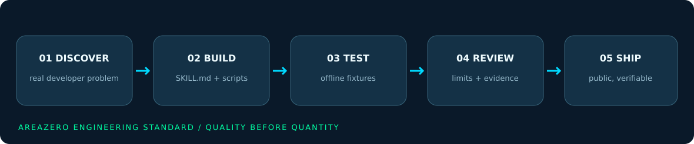
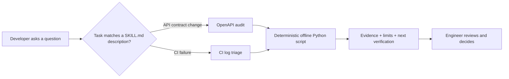

<p align="center">
  
</p>

<p align="center"></p>

<h3 align="center">Small, reliable Agent Skills for the messy parts of software engineering.</h3>

<p align="center">
  Two focused tools. Offline-first scripts. Reproducible examples. Clear limits.<br>
  Built by <b>Areazero Open Source Lab</b> for developers working with <b>Claude Code</b>, <b>Codex</b> and the command line.
</p>

<p align="center">
  <a href="https://github.com/Kanompung1988/agent-skills/actions/workflows/validate-skills.yml"></a>
  <a href="https://agentskills.io/specification"></a>
  
  <a href="LICENSE"></a>
  
</p>

<p align="center">
  <a href="#get-started"><b>Get started</b></a> &nbsp;·&nbsp;
  <a href="#the-skills"><b>Explore skills</b></a> &nbsp;·&nbsp;
  <a href="#see-it-work"><b>See it work</b></a> &nbsp;·&nbsp;
  <a href="#quality--validation"><b>Quality</b></a> &nbsp;·&nbsp;
  <a href="CONTRIBUTING.md"><b>Contribute</b></a> &nbsp;·&nbsp;
  <a href="SECURITY.md"><b>Security</b></a>
</p>

> [!IMPORTANT]
> **Evidence before claims.** These are conservative *static analysis helpers*, not proof that an API is compatible or that a suspected CI cause is correct. Neither tool makes network requests, fixes code, runs commands found in logs, or deploys anything. CI log redaction is best effort; review reports before sharing.

## Why this exists

Developer productivity isn't just writing more code. Release confidence erodes when API contracts drift silently and CI failures are buried under hundreds of irrelevant log lines. **Areazero builds narrow, inspectable tools that make the next engineering decision easier.** No invented AI benchmarks, no mystery dependencies, no automatic changes to your repository.

<p align="center"></p>

## The skills

<table>
<tr>
<td width="50%" valign="top">
<h3>01 · OpenAPI Compatibility Audit</h3>
<p><b>Catch likely breaking API changes before your clients do.</b></p>
<p>Compares old and new OpenAPI 3.x contracts and identifies removed routes, newly required inputs, narrowed request enums, dropped successful responses and more.</p>
<p><b>Output:</b> an explainable Markdown/JSON report with affected endpoints and severity.</p>
<p><a href="skills/openapi-compat-audit/"><b>Explore the skill →</b></a><br><a href="skills/openapi-compat-audit/SKILL.md">Agent instructions</a> · <a href="skills/openapi-compat-audit/scripts/compare_openapi.py">Python CLI</a></p>
</td>
<td width="50%" valign="top">
<h3>02 · CI Log Triage</h3>
<p><b>Go from a failed build to evidence, not guesses.</b></p>
<p>Groups TypeScript, test, dependency, Docker, permission and runner failures into useful hypotheses with line references and safe next checks.</p>
<p><b>Output:</b> a redacted Markdown/JSON evidence map. Scores indicate pattern specificity, not causal certainty.</p>
<p><a href="skills/ci-log-triage/"><b>Explore the skill →</b></a><br><a href="skills/ci-log-triage/SKILL.md">Agent instructions</a> · <a href="skills/ci-log-triage/scripts/triage_ci.py">Python CLI</a></p>
</td>
</tr>
</table>

| What matters | OpenAPI audit | CI triage |
|---|---|---|
| Typical trigger | "Will this API change break existing clients?" | "Why did this CI job fail?" |
| Input | Two local OpenAPI 3.x JSON/YAML specs | A local UTF-8 CI/build log |
| Output | Breaking vs manual-review findings | Evidence-linked hypotheses & follow-up tests |
| Runtime dependencies | Python 3.10+; PyYAML optional for YAML | Python 3.10+ standard library |
| External API calls | None | None |
| Automated source edits | None | None |

## Get started

Clone the public repository:

```bash
git clone https://github.com/Kanompung1988/agent-skills.git
cd agent-skills
```

**Codex (project skills):**

```bash
mkdir -p .agents/skills
cp -R skills/openapi-compat-audit skills/ci-log-triage .agents/skills/
```

**Claude Code (project skills):**

```bash
mkdir -p .claude/skills
cp -R skills/openapi-compat-audit skills/ci-log-triage .claude/skills/
```

The two folders are self-contained. You can also copy just the one you need. The agent discovers each `SKILL.md` from its project-level skills directory; restart your agent if it does not refresh. For personal skills, use `~/.agents/skills/` (Codex) or `~/.claude/skills/` (Claude Code). Folder conventions follow the [Codex skills guide](https://learn.chatgpt.com/docs/build-skills) and [Claude docs](https://platform.claude.com/docs/en/agents-and-tools/agent-skills/overview).

> [!TIP]
> **No agent required.** Each script is usable directly from your terminal. Both default to stdout; they only write a report when `--out` is provided.

## See it work

The following are **deterministic demo fixtures included in this repo** — not claimed measurements from a production system.

### Example 1: catch API contract drift

```bash
python3 skills/openapi-compat-audit/scripts/compare_openapi.py \
  --old examples/openapi-before.json \
  --new examples/openapi-after.json \
  --format markdown
```

**Actual fixture result:** **3 breaking findings** — a newly required `reference` field, removal of the `USD` request enum value, and removal of HTTP 201 from documented successful responses. Exit code **2** indicates detected breakage.

<details><summary><b>View reproducible report</b></summary>

See [the fixture report](examples/openapi-demo-report.md) for endpoint-level evidence, or run the CLI to regenerate it.

</details>

### Example 2: triage a failed CI job

```bash
python3 skills/ci-log-triage/scripts/triage_ci.py \
  --input examples/synthetic-ci.log \
  --format markdown
```

**Actual fixture result:** **3 signal categories across 9 lines**: TypeScript error `TS2345`, missing Python dependency, and a failed test assertion. Every result includes original source-line evidence and the next check. Exit code **0** means parsing succeeded; **it does not mean CI passed**.

<details><summary><b>View reproducible report</b></summary>

See [the fixture report](examples/ci-demo-report.md). Do not publish private CI logs or assume token redaction is exhaustive.

</details>

## How agent activation works



Each skill includes trigger guidance, non-trigger scenarios, a repeatable procedure, source code, tests and safety notes. The Agent Skills standard is intentionally small: just a skill folder with `SKILL.md`, plus optional scripts and references. [Read the specification](https://agentskills.io/specification).

## Quality & validation

On **2026-10-24**, the local release candidate was rerun in a Python execution container:

| Check | Result | How to reproduce |
|---|---|---|
| OpenAPI unit tests | 11 passed locally | `python3 -m unittest discover -s skills/openapi-compat-audit/tests -v` |
| CI triage unit tests | 11 passed locally | `python3 -m unittest discover -s skills/ci-log-triage/tests -v` |
| Distribution, metadata & brand tests | 10 passed locally | `python3 -m unittest discover -s tests -v` |
| Deterministic fixture smoke tests | See [CI workflow](.github/workflows/validate-skills.yml) | `python3 scripts/smoke_examples.py` |
| Python syntax check | See [CI workflow](.github/workflows/validate-skills.yml) | `python3 -m compileall -q skills tests scripts` |

The distribution suite includes documentation link checks, SVG syntax and unchanged official brand hashes (`tests/test_readme_assets.py`).

**GitHub Actions is the live source of truth for cloud CI:** [validate-skills workflow](https://github.com/Kanompung1988/agent-skills/actions/workflows/validate-skills.yml). It runs the checks on push and pull request for Python 3.10 and 3.12. The independent external reference validator (`skills-ref`) was not part of the original local 28 checks. Never interpret local scores as real-world adoption or measured accuracy.

See [quality review and known limitations](reports/QUALITY-REVIEW-2026-10-24.md), [eight candidate decisions](CANDIDATES-AND-SOURCES.md), and the [release changelog](CHANGELOG.md).

## Design decisions / boundaries

1. **No hidden cloud calls.** Scripts only inspect local documents; suitable for offline or sensitive development environments, subject to user policy.
2. **Evidence before diagnosis.** Breaking-change heuristics and log regex signals stay explainable. Manual review remains required for complex cases.
3. **Portable by default.** Readable Python 3.10+ rather than a framework-specific agent SDK.
4. **No auto-fixes or destructive steps.** Both scripts have explicit read-only behavior unless a report destination is selected.
5. **Real output, not marketing numbers.** Included sample inputs and test commands are the source for all demo claims.

## Repository map

```text
agent-skills/
├── assets/                   # Original brand logos + original vector artwork
├── skills/
│   ├── openapi-compat-audit/ # SKILL.md, CLI, references, tests, README
│   └── ci-log-triage/        # SKILL.md, CLI, references, tests, README
├── examples/                 # Synthetic fixtures + matching reports
├── scripts/                  # Release example smoke test
├── tests/                    # Metadata, links, CLI smoke + safety checks
├── reports/                  # QA findings and claim boundaries
├── .github/workflows/        # Python compatibility matrix and checks
├── CONTRIBUTING.md          # Contribution bar and verification
├── SECURITY.md              # Safe handling and reporting
└── LICENSE                  # MIT for code; marks excluded (BRAND.md)
```

## Limitations

- OpenAPI: not a semantic solver for `oneOf` / `anyOf` / `allOf`, remote references, security schemes, server URLs, undocumented runtime behavior or exhaustive SDK compatibility. Zero findings **does not prove compatibility**.
- CI logs: regex-based evidence is **not** a confirmed root-cause analysis. It may miss unfamiliar error formats, miss an earlier causal event or fail to redact a secret. Sanitize first, inspect outputs before sharing.
- Only synthetic fixtures were used for the documented demos. No external user outcomes, adoption data or third-party performance claims are implied.

## Contribute / roadmap

We value tests, minimal reproducible failures, explicit limitations and narrowly scoped improvements. Read [CONTRIBUTING.md](CONTRIBUTING.md) before opening a PR. Planned areas include external OpenAPI `$ref` *review warnings*, broader parameter coverage, and more CI failure patterns with safe synthetic fixtures; no unsupported "fully automated root cause" promise.

**If this saved you a debugging cycle, a GitHub star helps other developers discover the project.** Contributions and concrete bug reports are even better.

## Credits & license

Built by **Areazero Open Source Lab** · [GitHub @Kanompung1988](https://github.com/Kanompung1988). Original skill implementations and documentation are distributed under the [MIT License](LICENSE). Original Area Zero branding is used unchanged with permission and is **excluded** from the code license; see [BRAND.md](BRAND.md). The included demo data is synthetic.

<p align="center"><sub>AREAZERO · Build useful things. Show the evidence. Improve in public.</sub></p>
