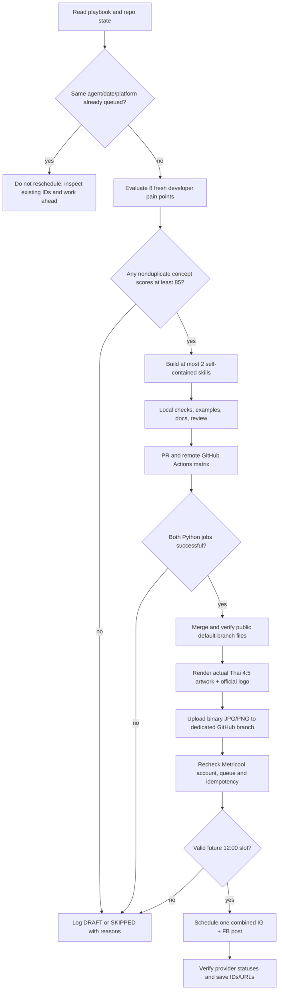

# AREAZERO Skill Lab — autonomous release operations

> **Series:** AREAZERO Skill Lab · *Make AI more useful every day*  
> **Thai public tagline:** ทำให้ AI เก่งขึ้นทุกวัน  
> **GitHub:** [Kanompung1988/agent-skills](https://github.com/Kanompung1988/agent-skills)  
> **Related, separate series:** Daily AI Scout (news and AI trends, **not** software releases).

This document is the reproducible operations contract for an autonomous daily run. It does not grant new tool permissions; use only connected, authorized services and verify every external result. Quality outranks daily output volume. A missed day is better than an untested public claim.

## What ships

Each successful episode announces **one combined set of one or two new, tested Agent Skills**. Never create two separate promotional posts for two skills on the same day. A finished skill is a portable directory with `SKILL.md`, `README.md`, implementation scripts where needed, focused references, LICENSE / attribution, synthetic examples, tests and limitations. Public README text and code are English; Instagram/Facebook marketing is Thai.

- **Skill code owner:** `Kanompung1988/agent-skills` (public repo; `main` is publication source of truth).
- **Social media assets/log owner:** `Kanompung1988/Bot_new_areazero`, only branch `areazero-social-assets` (never modify that repository's main for posts).
- **Instagram:** `@areazero.ai` and **Facebook Page:** `AreaZero`, via Metricool brand `7611512` (check actual network account identity each run).
- **Publication:** exactly `12:00:00` `Asia/Bangkok`, using autoPublish; *preparation time is not publication time*.
- **Series line:** `AREAZERO Skill Lab | EP.XX — ทำให้ AI เก่งขึ้นทุกวัน`. Episode numbers count **verified public releases**, not dates or failed drafts.

## Daily state machine

### Morning agent run

1. Load the **latest** `AUTOMATION_PLAYBOOK.md` on `areazero-social-assets`, this document, previous day logs, today's existing calendar queue, the public GitHub repo and current skills directory. Check what the other series (Daily AI Scout) is doing so the stories are distinct.
2. Fetch at least **8** specific developer pain points, supported by public docs/real engineering friction (date the sources). Check competing open-source approaches and *every currently published skill path* in the owner repo. Reject near-duplicates and weak wrappers.
3. Score each concept with the same weighted rubric as `CANDIDATES-AND-SOURCES.md`: utility **25**, distinctiveness **20**, Claude Code/Codex relevance **15**, build feasibility **15**, audience **10**, demonstration/evidence **10**, shareability **5**. These are **editorial estimates**, never user adoption data. Record all 8 and reasons; only advance score **>=85/100**. One excellent skill is preferable to two rushed ones; zero acceptable results means no promotional post.
4. Construct the complete portable skill. Follow [Agent Skills specification](https://agentskills.io/specification): `name` is lowercase kebab-case, 1-64 chars, equals folder; `description` is 1-1024 chars and describes trigger; complete frontmatter + Markdown instructions. Include explicit when-not-to-use, examples, failure cases, permissions, references, reproducible code, a license and tests. Keep the content safe for a public repo: no secrets/private logs/license-incompatible material.
5. Test in a real execution environment. Run `python scripts/validate_skills.py --check`, `python scripts/validate_skills.py --run-tests`, `python -m unittest discover -s tests -v`, and `python scripts/smoke_examples.py`. Use Python 3.10 and 3.12 matrix remotely. If available, ALSO run `skills-ref validate skills/<slug>` and document whether it passed; **never claim official validation unless executed**. Review edge cases, inspect CLI output and cite test evidence accurately. Do not manufacture an independent review.
6. Branch from current `main`, submit a meaningful PR with candidates, usage, known limitations, test evidence and licensing. Wait for actual successful **all** required GitHub Actions jobs on the latest head SHA. Failed/queued/unknown checks block merge; fix in branch and run again. Do not force-push or bypass failed checks. If permissions allow and checks are green, merge and verify exact `SKILL.md` paths on the **public default branch**. The merged commit/PR URL are facts of record.
7. For a post-worthy public release, make **one** polished 1080×1350 (4:5) Thai artwork. Include a useful hero tech graphic/real fixture output, correct `EP.XX`, no invented screenshots or metrics, and composite the **unaltered owner logo** from `Kanompung1988/Areazerowebsite/public/logo-full.svg` or the trusted `/Areazero/Brand Assets/` library copy. Keep original aspect ratio and cyan `#00D9FF`, mint `#00FFA3`, navy `#0A1929`. Inspect the rendered JPG/PNG with vision at full size for Thai spelling/tofu glyphs. A prompt alone is not an image asset.
8. Write a Thai caption with the series label, developer problem, what the skill actually does, verifiable tests, GitHub repository and exact paths, limitations and CTA to star/issue/PR. Say `แจกฟรี` **only** when the public source exists; otherwise use `กำลังพัฒนา` and leave marketing in DRAFT. Do not overpromise autonomous intelligence or unsupported impact.
9. **Before any social write**, get Metricool brand settings + queue for the destination date and inspect `posts/YYYY-MM-DD/open-source-lab-publication.json` and any earlier agent-specific log. Key = `YYYY-MM-DD:areazero-open-source-lab:<instagram|facebook>`. An existing `SCHEDULED`, `PENDING`, `PUBLISHING` or `PUBLISHED` key is a hard barrier for that network; `DRAFT` is not. Check social account identity, not brand ID alone.
10. Schedule one combined post to both providers **exactly** at `YYYY-MM-DDT12:00:00+07:00` with `autoPublish:true`, `draft:false`, publication timezone `Asia/Bangkok`, actual public media and the expected Instagram/Facebook networkData. Check the resulting UUID, fresh post ID, provider statuses, scheduled time and real planner URL. Store the complete caption and image path + blob SHA + commit-pinned raw URL. `PENDING` is `SCHEDULED`, never `PUBLISHED`; only provider-confirmed published URLs qualify.
11. Update `docs/EPISODES.md` with verified code evidence after release; save candidate decisions, release evidence and exact social status to the GitHub asset branch under agent-specific paths. Return a concise state per target: `PUBLIC`, `SCHEDULED`, `DRAFT`, `BLOCKED` and actual links. Do not confuse successful automation execution with successful platform posting.

## Scheduling and backlog behavior

- Start preparation early each morning, but **never post during preparation**. Noon is the scheduled publication moment.
- If a previous episode is already scheduled for today's noon (e.g. launch EP.01 on **2026-10-25**, Metricool UUID `2137186428519728769`), **do not create or reschedule another Skill Lab post for that date**. Continue building skills only when useful; put validated new work into the next free date's backlog.
- Before researching new ideas, inspect any previously validated, unscheduled public release candidate. Prioritize publishing that existing work over duplicating it.
- If CI is not green or source is not public by the safe planning cutoff (suggest 11:30 ICT), never publish a placeholder. Carry a still-timely release to the **next verified empty date at exactly 12:00**, keeping its actual release date in the copy. Do not schedule into the past, and do not silently reassign a different series' slot.
- If Metricool is unavailable, identity mismatches, image transport is blocked, or the scheduled entry can't be verified, keep real artifacts and a `DRAFT`/`BLOCKED` report. Do not invent IDs, reuse yesterday's image, or retry a potentially successful creation without checking the UUID/queue first.
- The sibling **Daily AI Scout** is a separate agent with different story selection and its own idempotency keys; do not confuse a news post with a Skill Lab episode. Cross-series simultaneous noon posts are permitted under existing per-agent rules, but each can schedule at most one post per provider/date.

## Tested image-to-GitHub transport (no Google Drive)

1. Produce the actual image locally, check MIME, width/height, content and SHA-256. Convert **image bytes** to Base64. Never encode a filename or image asset pointer.
2. Since the ChatGPT JS tool isolate may not read the container filesystem, if necessary write Base64 in **small UTF-8 .txt chunks** (e.g. 10–25 KB), upload these temporary files to `/Areazero/Publishing/` using `files__manage_library`, and read their complete contents through `files__read` in `functions.exec` (verify no truncation, exact combined encoded length and characters). Keep the Base64 **out of user-facing messages**.
3. Pass the assembled string to GitHub `create_blob(encoding="base64")` for `Bot_new_areazero`. Use `fetch_commit` to read the current asset-branch commit SHA; use `GET /git/commits/{commitSHA}` to obtain its **tree SHA**. When calling `create_tree`, set `base_tree_sha` to the **TREE SHA, not the commit SHA**, and add the new image blob path. Create a commit with parent = prior commit SHA; update branch ref with `force:false` and `expected_sha` prior HEAD. On a race, re-read branch and reconcile instead of force-overwriting another agent's work.
4. Confirm the committed asset's Git tree has the correct path, blob SHA and nonzero size. Construct a **commit-pinned** `raw.githubusercontent.com` URL. Metricool's successful media ingest (returned Metricool media URL) provides additional validation; do not claim a broken/unverified raw URL is valid.
5. Remove temporary Base64 bridge text files from Library after verified upload and log, preserving source artwork and hash elsewhere. Never use Google Drive.

## Idempotency, updating and post-publication QA

- A scheduled post is keyed by **stable Metricool UUID**, while `updateScheduledPost` returns a **new post ID**. Always refresh the scheduled post, preserve the full providers/media/metadata, omit unrelated network data, and update the stored ID/UUID rather than creating a second post.
- A scheduled item may disappear from `getScheduledPosts` after its due time. **Absence does not prove publishing or failure.** Query available per-provider statuses and links using authorized Metricool tools and logs. Do not republish unless a failed or unsent state is proven and user permission permits.
- The existing daily noon QA task should inspect both series after 12:00, verify each provider's final public URL/status when supported, flag mismatches and preserve immutable source/commit links. Notifications help surface blockers; they are not posting confirmations.
- Avoid editing or deleting other agents' posts, mixing asset branches or leaking PATs/Secrets.

## Quality, reputation and disclosure

We build developer trust by shipping credible reproducible artifacts, not by maximizing the daily post count. No made-up GitHub stars, adoption, CI runs, performance claims or independent review. Explicitly state known limitations, use synthetic example fixtures, support Issues and PRs, and update README/CHANGELOG when behavior changes. Official brand logos remain outside the MIT grant (see `BRAND.md`).

### Current verified launch baseline — 2026-10-24

- `Kanompung1988/agent-skills` exists and is public on `main`.
- First release: `openapi-compat-audit`, `ci-log-triage`; PR #1 merged, CI Python 3.10 and 3.12 **32 unit tests + 2 smoke tests per version** (Run `40090285727`). Official `skills-ref` and independent review were **not** run for that initial release.
- `AREAZERO Skill Lab | EP.01` is scheduled for **2026-10-25 12:00 Asia/Bangkok** on existing Metricool UUID `2137186428519728769` for IG and FB. Latest edit assigned ID `404941924`; both providers `PENDING` when last checked, not `PUBLISHED`. This is an idempotency barrier for 2026-10-25; do not create another episode for that date.
- Social log: [Oct 25 publication record](https://github.com/Kanompung1988/Bot_new_areazero/blob/areazero-social-assets/posts/2026-10-25/open-source-lab-publication.json).