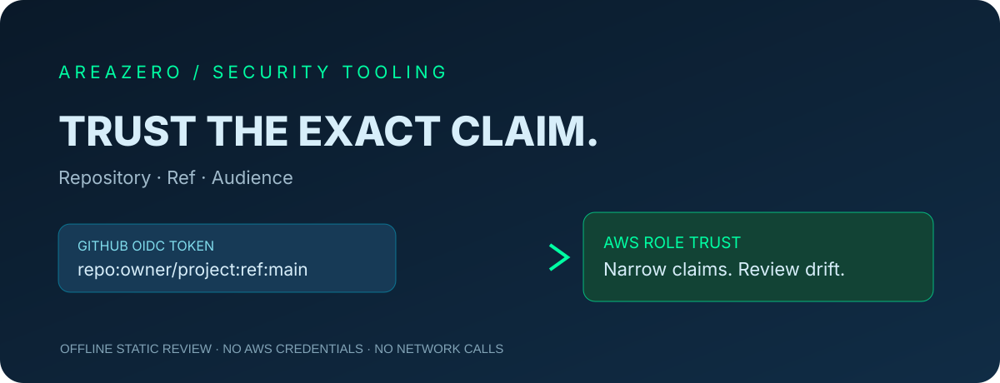

<p align="center"></p>
<p align="center"></p>
<h2 align="center">Know what your GitHub OIDC role really trusts.</h2>
<p align="center">A conservative, offline AWS IAM trust-policy review assistant — built for Claude Code and Codex.</p>
<p align="center"><a href="https://github.com/Kanompung1988/aws-github-oidc-trust-audit/actions/workflows/ci.yml"></a> &nbsp; <a href="https://agentskills.io/specification">Agent Skills spec</a> · <a href="LICENSE">MIT code</a></p>

## Why this matters
GitHub Actions can obtain AWS credentials through OIDC without long-lived AWS keys. A role trust policy that accidentally accepts multiple repositories, all branches or unmatched audiences may cross your intended deployment boundary. This tool checks only the **trust policy document**, locally, with a statement index and explicit confidence boundaries.

## Quickstart
```bash
git clone https://github.com/Kanompung1988/aws-github-oidc-trust-audit.git
cd aws-github-oidc-trust-audit
python scripts/audit.py examples/safe.json --format json
python scripts/audit.py examples/review.json --format text --fail-on high
python scripts/audit.py /path/to/trust-policy.json --format json --fail-on review
python -m unittest discover -s tests -v
```

The synthetic review case reports `BROAD_REPOSITORY_SUB`. Exit codes: 0 = threshold clear, 1 = findings at threshold, 2 = invalid input. An empty report is **not** an AWS authorization proof.

## Install as a portable Agent Skill
**Claude Code** (project-local):
```bash
mkdir -p .claude/skills
git clone https://github.com/Kanompung1988/aws-github-oidc-trust-audit.git .claude/skills/aws-github-oidc-trust-audit
```
**Codex** (project-local):
```bash
mkdir -p .agents/skills
git clone https://github.com/Kanompung1988/aws-github-oidc-trust-audit.git .agents/skills/aws-github-oidc-trust-audit
```
Read `SKILL.md` to activate the workflow. Uses Python 3.10+ standard library; no API token, `aws` CLI, third-party dependencies or network access needed.

## Evidence model
| Finding | Meaning |
|---|---|
| `MISSING_POSITIVE_SUB` (HIGH) | No recognized positive GitHub subject key |
| `BROAD_REPOSITORY_SUB` (HIGH) | Repository owner/name could match a wider identity |
| `WILDCARD_REF_SUB` (REVIEW) | Ref/context contains a glob |
| `ENVIRONMENT_GATES` (REVIEW) | Environment condition; separately check GitHub approvals |
| `MISSING_POSITIVE_AUD` (HIGH) | No recognized positive audience |
| `UNSUPPORTED_OPERATOR` (REVIEW) | Could not confidently model condition form |

## Package map
`SKILL.md` agent procedure · `scripts/audit.py` deterministic scanner · `tests/test_audit.py` unit + CLI tests · `examples/` synthetic policies · `references/MODEL.md` source/assumptions · `assets/hero.svg` original illustration · `assets/area-zero-logo-full.svg` exact owner-provided logo.

## Security and limits
- No live AWS/IAM reads, modifications or network calls.
- Input is JSON only, max 2 MB per file and max 100 files; symlinks and duplicate JSON keys rejected.
- Only modeled `Allow` + GitHub OIDC `AssumeRoleWithWebIdentity` statements. Complex IAM condition operators and custom OIDC subject templates require independent review. Reports do not print subject literal values.
- Real exposure depends on all trust statements, environment controls, repository access, session policies and AWS resource permissions. Use AWS IAM tools before making decisions.

## Contribute and attribution
See [CONTRIBUTING.md](CONTRIBUTING.md), [SECURITY.md](SECURITY.md) and [references/MODEL.md](references/MODEL.md). Source code is MIT. The exact Area Zero brand logo is excluded from the code license and belongs to its rights holder.

## Authoritative sources
- https://docs.aws.amazon.com/IAM/latest/UserGuide/id_roles_create_for-idp_oidc.html
- https://docs.github.com/en/actions/how-tos/secure-your-work/security-harden-deployments/oidc-in-aws
- https://agentskills.io/specification
