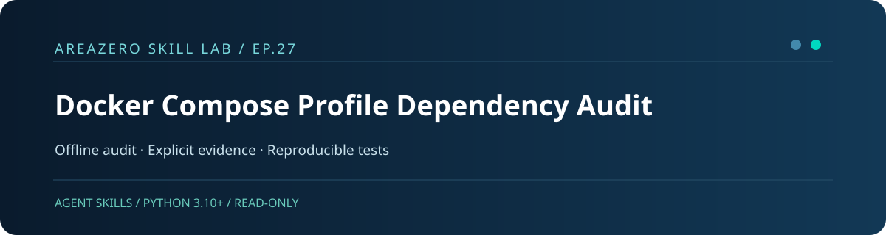

<p align="center"></p>
<p align="center"></p>

# Docker Compose Profile Dependency Audit

**Catch dependencies excluded by Compose profile selections before your stack fails to start.**

[](https://github.com/Kanompung1988/compose-profile-dependency-audit/actions/workflows/ci.yml)
[](https://agentskills.io/specification)
[](LICENSE)

Read one local Docker Compose YAML file, model default, individual-profile and explicitly targeted service invocations, then flag required dependencies excluded by active profiles, unknown service references, and cycles. No Docker daemon, container launch, or network call.

## Quick start

```bash
python -m venv .venv
source .venv/bin/activate  # Windows: .venv\Scripts\activate
python -m pip install -r requirements.txt
python scripts/audit.py fixtures/safe.yaml --format json
python scripts/audit.py fixtures/review.yaml --format json
```

**Exit codes:** 0 = no findings in this bounded review; 2 = review required; 1 = malformed input / local error. In CI, capture and explicitly assert the expected `2` for review fixtures.

```bash
python -m unittest discover -s tests -v
```

## Installation as an Agent Skill

Clone this standalone repository, then put the **entire folder** (including `SKILL.md`, scripts, fixtures and references) at either location:

- **Claude Code:** `.claude/skills/compose-profile-dependency-audit/` inside a project or `~/.claude/skills/compose-profile-dependency-audit/` globally.
- **Codex:** `.agents/skills/compose-profile-dependency-audit/` inside a project or `~/.agents/skills/compose-profile-dependency-audit/` globally.

Example for a project-local install:

```bash
git clone https://github.com/Kanompung1988/compose-profile-dependency-audit.git /tmp/compose-profile-dependency-audit
mkdir -p .agents/skills/compose-profile-dependency-audit
cp -R /tmp/compose-profile-dependency-audit/. .agents/skills/compose-profile-dependency-audit/
```

Keep the original `SKILL.md` name and folder slug identical. Install PyYAML in the environment that runs `scripts/audit.py`.

## How to interpret findings

The tool evaluates **hypothetical scenarios**: no active profile, each declared profile independently, and an optional requested invocation. A warning in an uninvoked scenario does not mean a real deployment is broken. `depends_on: {svc: {required: false}}` is not treated as a hard dependency. External `extends.file`, variables, service extensions, networks and multi-file merge are unresolved by design.

The script reads only one local file, does not connect to external services, and makes no claims about production safety, complete YAML schema coverage, third-party validation or external usage.

## Evidence and authority

- [Primary reference](https://docs.docker.com/reference/compose-file/profiles/)
- [Operational reference](https://docs.docker.com/compose/how-tos/profiles/)
- [Technical rule notes](references/REFERENCE.md)
- [Agent Skills open specification](https://agentskills.io/specification)

## Contributing and security

See [CONTRIBUTING.md](CONTRIBUTING.md) for reproducible tests and [SECURITY.md](SECURITY.md) for vulnerability reporting. The source code is MIT licensed; the official Area Zero logo is retained unmodified and **not** relicensed under MIT.

Built by [AREAZERO Skill Lab](https://github.com/Kanompung1988/agent-skills) · 2026-11-20. This repository is the code source; the portfolio is an index only.
