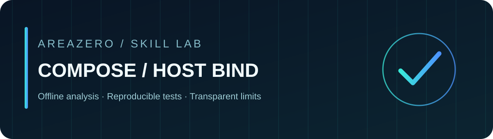

<p align="center"></p>
<p align="center"></p>

# Compose Published Port Audit

**Review host-bind exposure contracts in Docker Compose before deployment.** A small portable Agent Skill, no daemon access, no network calls, no file modification.

[](https://github.com/Kanompung1988/compose-published-port-audit/actions/workflows/ci.yml) · [Agent Skills specification](https://agentskills.io/specification) · MIT

## What it checks

- Explicit wildcard host IPs (`0.0.0.0`, `[::]`) — high-priority review.
- Omitted host IPs — review because daemon/network defaults may expose all interfaces.
- Explicit non-loopback interfaces, dynamic address interpolation, invalid port syntax and host networking — manual review.
- Long-form and short-form port mappings. `expose` without `ports` is intentionally excluded.

## Quick start

```bash
git clone https://github.com/Kanompung1988/compose-published-port-audit.git
cd compose-published-port-audit
python -m pip install -r requirements.txt
python scripts/audit.py fixtures/safe.yaml --strict
python scripts/audit.py fixtures/review.yaml --format json --strict  # exits 2 on findings
python -m unittest discover -s tests -v
```

Exit codes: `0` successful analysis with no findings (or analysis in non-strict mode); `1` invalid/unreadable input; `2` findings in strict mode.

### Claude Code

Clone into `.claude/skills/compose-published-port-audit` under your project, or your user skills directory. The root `SKILL.md` describes when an agent should activate it.

### Codex

Clone into `.agents/skills/compose-published-port-audit` under your project or `$HOME/.agents/skills/compose-published-port-audit`. Codex can read `SKILL.md` and invoke `scripts/audit.py` on approved local files.

### Safety and limitations

The auditor does not execute Docker or inspect host/network/firewall policy, environment variable values, Compose overrides or deployed containers. Its findings are review prompts, **not proof of public reachability**. Avoid feeding real secrets. For full semantics consult [official Docker docs](https://docs.docker.com/engine/network/port-publishing/) and [reference](references/REFERENCE.md).

Contributions and tests are welcome via pull requests and [CONTRIBUTING.md](CONTRIBUTING.md). Original AREAZERO logo is retained as supplied; code under MIT. No third-party security certification is claimed.
