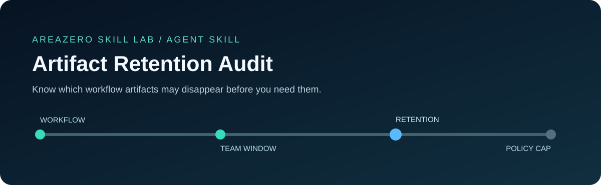

<p align="center"></p>
<p align="center"></p>

<h3 align="center">Make artifact retention reviewable before the workflow ships.</h3>

<p align="center"><a href="https://github.com/Kanompung1988/gha-artifact-retention-audit/actions/workflows/ci.yml"></a> · <a href="https://agentskills.io/specification">Open Agent Skills specification</a> · <a href="LICENSE">MIT code</a></p>

# GitHub Actions Artifact Retention Audit

A portable **Agent Skill** for Claude Code and Codex that checks local GitHub Actions `actions/upload-artifact` retention settings against documented limits and an operator-supplied effective policy. Useful for avoiding silently too-short diagnostic windows or overly long, invalid retention requests. Nothing is uploaded or deleted.

## What this catches

- Invalid or out-of-range `retention-days`, with explicit assumptions for public (90-day) and private (400-day) maximums.
- Values exceeding a **supplied** effective policy, or below a **supplied** minimum incident-review window.
- Defaults that may hide a retention-shortfall and expressions that cannot be resolved by offline analysis.
- Nested workflow jobs and steps using `actions/upload-artifact@...` in a given workflow directory.

## Quickstart

```bash
git clone https://github.com/Kanompung1988/gha-artifact-retention-audit.git
cd gha-artifact-retention-audit
python -m pip install -r requirements.txt
python scripts/audit.py fixtures/safe.yml --visibility public --policy-days 90 --minimum-days 7 --strict
python scripts/audit.py fixtures/review.yml --visibility public --policy-days 60 --minimum-days 14 --format json
python -m unittest discover -s tests -v
```

For your own files, run:

```bash
python scripts/audit.py /path/to/project/.github/workflows --visibility public --policy-days 60 --minimum-days 14 --format text
```

`--policy-days` and `--minimum-days` are supplied operator parameters; **the tool never queries live GitHub settings**. JSON output lists severity, stable code, location and explanation. With `--strict`, return code `2` means at least one finding; `1` means bad input; `0` means no detected findings. The review fixture is synthetic, not a production finding.

## Install for Claude Code or Codex

Install as an independent skill directory (the root includes `SKILL.md`):

**Claude Code — project-local:**

```bash
mkdir -p .claude/skills
git clone https://github.com/Kanompung1988/gha-artifact-retention-audit.git .claude/skills/gha-artifact-retention-audit
python -m pip install -r .claude/skills/gha-artifact-retention-audit/requirements.txt
```

**Codex — project-local:**

```bash
mkdir -p .agents/skills
git clone https://github.com/Kanompung1988/gha-artifact-retention-audit.git .agents/skills/gha-artifact-retention-audit
python -m pip install -r .agents/skills/gha-artifact-retention-audit/requirements.txt
```

Ask the coding agent to check your workflow retention contract, state assumptions, and propose any changes as a reviewable diff. The agent should follow the steps in `SKILL.md`.

## Layout and quality gates

| File | Responsibility |
|---|---|
| `SKILL.md` | Activation rules and explicit procedure |
| `scripts/audit.py` | Offline parser and CLI; no GitHub API or artifact access |
| `tests/test_audit.py` | Regressions and safety-boundary tests |
| `tests/check_metadata.py` | Frontmatter and original brand SHA256 integrity checks |
| `fixtures/` | Synthetic safe and review cases |
| `references/REFERENCE.md` | Semantics, authoritative documentation and non-goals |
| `.github/workflows/ci.yml` | Python 3.10/3.12 unit + CLI + metadata checks |

## Limitations and safety

Not a compliance guarantee or runtime verification. Effective retention can depend on repository, organization and enterprise settings, product limits, repository visibility, storage policy, GitHub version, artifact creation date, run status and dynamic expressions. The input files can still be invalid workflow YAML by GitHub's own schema. This tool does not query GitHub, inspect/decrypt artifacts, evaluate expressions, or prove the effective deletion time. Review actual settings with a repository admin before drawing conclusions.

Code MIT. Original Area Zero identity assets are not covered by the software license and must not be copied into unrelated branding. See [CONTRIBUTING.md](CONTRIBUTING.md) and [references/REFERENCE.md](references/REFERENCE.md).
