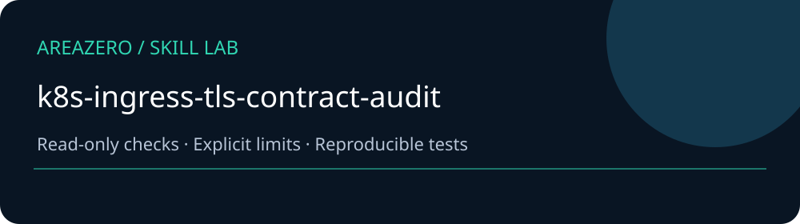

<p align="center"></p>
<p align="center"></p>

# Kubernetes Ingress TLS Contract Audit

[](https://github.com/Kanompung1988/k8s-ingress-tls-contract-audit/actions/workflows/ci.yml) [Agent Skills spec](https://agentskills.io/specification) · MIT

**Catch TLS host drift and mismatched Secret metadata without accessing a Kubernetes cluster.** Inspect supplied local Kubernetes v1 Ingress and TLS Secret YAML; classify uncertain controller behavior as review findings.

## Quickstart

```bash
python -m venv .venv
. .venv/bin/activate
python -m pip install -r requirements.txt
python scripts/audit.py examples/safe.yaml --json
python scripts/audit.py examples/review.yaml --json
python -m unittest discover -s tests -v
```

Exit 0 clean (or review-only by default), 2 errors, 1 invalid input. `--fail-on review` and `--fail-on never` supported. **Use synthetic or sanitized manifests only**: do not paste actual TLS private keys into AI tools. The script compares Secret key names, not values.

## Claude Code and Codex

Clone the repository and place its **entire directory** in `~/.claude/skills/k8s-ingress-tls-contract-audit/` (Claude Code) or `~/.agents/skills/k8s-ingress-tls-contract-audit/` (Codex). Keep `SKILL.md`, scripts and references together; install PyYAML in an isolated Python environment. Provide only redacted manifest files. Analyze every finding before changing any live Kubernetes resources.

## Scope

No certificate validity, hostname SAN matching, Ingress controller configuration, cluster reads, HTTP/TLS traffic or workload checks. Missing Secrets in a provided batch are not proof of absence on the cluster. See [reference](references/REFERENCE.md), [contributing](CONTRIBUTING.md), [MIT License](LICENSE).
