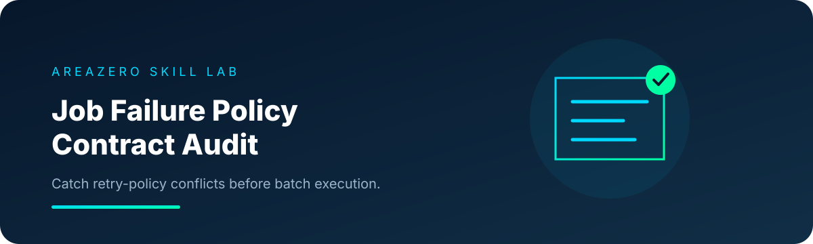

<p align="center"></p>
<p align="center"></p>

# Kubernetes Job Failure Policy Audit

**Catch incompatible retry policies and malformed Pod failure rules before a batch workload is created.**

[](https://github.com/Kanompung1988/k8s-job-failure-policy-audit/actions/workflows/ci.yml)
[](https://agentskills.io/specification)
[](LICENSE)

Offline, read-only analysis of Kubernetes `batch/v1` Job and CronJob manifests. Checks `podFailurePolicy`, `restartPolicy`, exit-code matchers, container references, `podReplacementPolicy`, indexed retry settings, `FailIndex`, and backoff defaults. No cluster access or workload execution.

## Quick start

```bash
python -m venv .venv
source .venv/bin/activate  # Windows: .venv\Scripts\activate
python -m pip install -r requirements.txt
python scripts/audit.py fixtures/safe.yaml --format json
python scripts/audit.py fixtures/review.yaml --format json
python -m unittest discover -s tests -v
```

**Exit codes:** `0` = no findings at the selected threshold; `2` = review findings; `1` = invocation/input discovery error. A zero exit code is not proof that a Job will finish successfully.

## Agent Skill installation

Clone this repository and copy the full folder, preserving `SKILL.md`, `scripts/`, `references/`, and `requirements.txt`.

- **Claude Code (project):** `.claude/skills/k8s-job-failure-policy-audit/`
- **Claude Code (global):** `~/.claude/skills/k8s-job-failure-policy-audit/`
- **Codex (project):** `.agents/skills/k8s-job-failure-policy-audit/`
- **Codex (global):** `~/.agents/skills/k8s-job-failure-policy-audit/`

```bash
git clone https://github.com/Kanompung1988/k8s-job-failure-policy-audit.git /tmp/k8s-job-failure-policy-audit
mkdir -p .agents/skills/k8s-job-failure-policy-audit
cp -R /tmp/k8s-job-failure-policy-audit/. .agents/skills/k8s-job-failure-policy-audit/
python -m pip install -r .agents/skills/k8s-job-failure-policy-audit/requirements.txt
```

## What matters most

A Job using `podFailurePolicy` must set `restartPolicy: Never`. Rules are evaluated in order and the first match wins. Indexed retry controls have additional constraints; when `backoffLimitPerIndex` is set, the default `backoffLimit` changes to 2147483647 if omitted. See [Technical reference](references/REFERENCE.md).

## Security and limitations

The parser uses `yaml.safe_load_all`. It does not run commands, execute workloads, access clusters, or read Secrets. The audit is a bounded static check, not full Kubernetes OpenAPI validation or a controller simulator. Always validate against the target cluster version and test retry semantics with application owners.

## Contributing

Add a focused regression test and fixture for each rule. Run `python -m unittest discover -s tests -v` and both CLI fixtures before opening a PR. See [LICENSE](LICENSE).

Built by AREAZERO Skill Lab · 2026-11-21. Each Skill is independently maintained; the [portfolio](https://github.com/Kanompung1988/agent-skills) is an index only.
