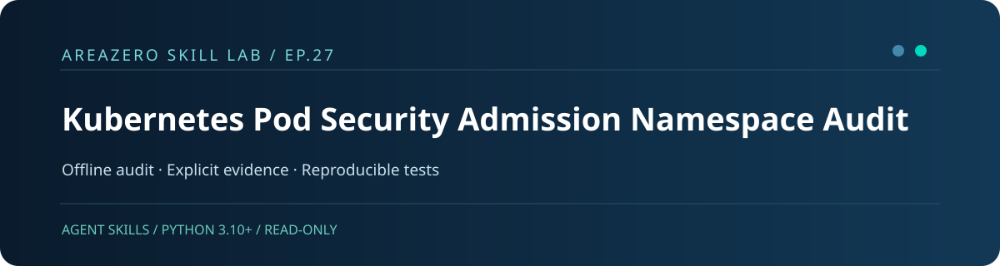

<p align="center"></p>
<p align="center"></p>

# Kubernetes Pod Security Admission Namespace Audit

**Review namespace Pod Security Admission levels and version pins before deployment.**

[](https://github.com/Kanompung1988/k8s-psa-namespace-audit/actions/workflows/ci.yml)
[](https://agentskills.io/specification)
[](LICENSE)

Statically inspect local Kubernetes Namespace manifests for Pod Security Admission labels, invalid level/version values, annotation-vs-label mistakes, missing operator-required enforcement, privileged enforcement, weak observability modes, unpinned versions and duplicate Namespace definitions. No cluster connection or pod evaluation.

## Quick start

```bash
python -m venv .venv
source .venv/bin/activate  # Windows: .venv\Scripts\activate
python -m pip install -r requirements.txt
python scripts/audit.py fixtures/safe.yaml --format json
python scripts/audit.py fixtures/review.yaml --format json
```

**Exit codes:** 0 = no findings in this bounded review; 2 = review required; 1 = malformed input / local error. In CI, capture and explicitly assert the expected `2` for review fixtures.

```bash
python -m unittest discover -s tests -v
```

## Installation as an Agent Skill

Clone this standalone repository, then put the **entire folder** (including `SKILL.md`, scripts, fixtures and references) at either location:

- **Claude Code:** `.claude/skills/k8s-psa-namespace-audit/` inside a project or `~/.claude/skills/k8s-psa-namespace-audit/` globally.
- **Codex:** `.agents/skills/k8s-psa-namespace-audit/` inside a project or `~/.agents/skills/k8s-psa-namespace-audit/` globally.

Example for a project-local install:

```bash
git clone https://github.com/Kanompung1988/k8s-psa-namespace-audit.git /tmp/k8s-psa-namespace-audit
mkdir -p .agents/skills/k8s-psa-namespace-audit
cp -R /tmp/k8s-psa-namespace-audit/. .agents/skills/k8s-psa-namespace-audit/
```

Keep the original `SKILL.md` name and folder slug identical. Install PyYAML in the environment that runs `scripts/audit.py`.

## How to interpret findings

Default `--minimum-enforce baseline` is an **operator policy** rather than an upstream Kubernetes requirement. Set `--minimum-enforce none` to disable that policy. `--require-pinned-version` is opt-in; `latest` is valid but may evolve with the cluster. An exemption flag only suppresses local review and does not configure a real cluster exemption.

The script reads only one local file, does not connect to external services, and makes no claims about production safety, complete YAML schema coverage, third-party validation or external usage.

## Evidence and authority

- [Primary reference](https://kubernetes.io/docs/concepts/security/pod-security-admission/)
- [Operational reference](https://kubernetes.io/docs/tasks/configure-pod-container/enforce-standards-namespace-labels/)
- [Technical rule notes](references/REFERENCE.md)
- [Agent Skills open specification](https://agentskills.io/specification)

## Contributing and security

See [CONTRIBUTING.md](CONTRIBUTING.md) for reproducible tests and [SECURITY.md](SECURITY.md) for vulnerability reporting. The source code is MIT licensed; the official Area Zero logo is retained unmodified and **not** relicensed under MIT.

Built by [AREAZERO Skill Lab](https://github.com/Kanompung1988/agent-skills) · 2026-11-20. This repository is the code source; the portfolio is an index only.
