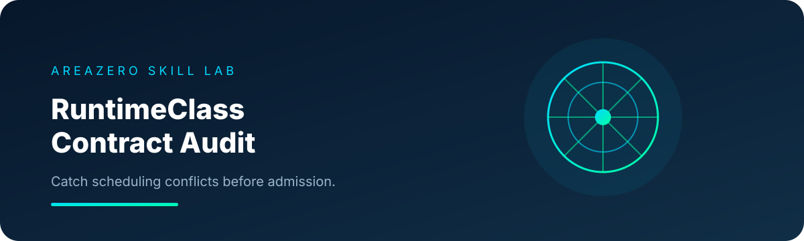

<p align="center"></p>
<p align="center"></p>

# Kubernetes RuntimeClass Contract Audit

**Catch RuntimeClass scheduling conflicts and malformed Pod overhead before Kubernetes admission.**

[](https://github.com/Kanompung1988/k8s-runtimeclass-contract-audit/actions/workflows/ci.yml)
[](https://agentskills.io/specification)
[](LICENSE)

Offline, read-only inspection of Kubernetes RuntimeClass and Pod YAML. It checks `runtimeClassName` references, handler and scheduling field shapes, conflicting merged `nodeSelector` keys, and conservative `overhead.podFixed` quantity syntax. It never contacts a cluster or runs `kubectl`.

## Quick start

```bash
python -m venv .venv
source .venv/bin/activate  # Windows: .venv\Scripts\activate
python -m pip install -r requirements.txt
python scripts/audit.py fixtures/safe.yaml --format json
python scripts/audit.py fixtures/review.yaml --format json
python -m unittest discover -s tests -v
```

**Exit codes:** `0` = no findings at the selected threshold; `2` = review findings; `1` = invocation/input discovery error. A zero exit code does not prove production safety.

## Agent Skill installation

Clone this standalone repository and copy the complete folder so `SKILL.md`, `scripts/`, `references/`, and `requirements.txt` remain together.

- **Claude Code (project):** `.claude/skills/k8s-runtimeclass-contract-audit/`
- **Claude Code (global):** `~/.claude/skills/k8s-runtimeclass-contract-audit/`
- **Codex (project):** `.agents/skills/k8s-runtimeclass-contract-audit/`
- **Codex (global):** `~/.agents/skills/k8s-runtimeclass-contract-audit/`

```bash
git clone https://github.com/Kanompung1988/k8s-runtimeclass-contract-audit.git /tmp/k8s-runtimeclass-contract-audit
mkdir -p .agents/skills/k8s-runtimeclass-contract-audit
cp -R /tmp/k8s-runtimeclass-contract-audit/. .agents/skills/k8s-runtimeclass-contract-audit/
python -m pip install -r .agents/skills/k8s-runtimeclass-contract-audit/requirements.txt
```

## Findings and interpretation

The critical check is a conflicting selector key: Kubernetes merges the RuntimeClass and Pod selectors, and conflicting values reject the Pod at admission. Tolerations are appended rather than intersected. A RuntimeClass not present in the supplied files is reported as informational because it may be defined in the cluster or another repository.

See [Technical reference](references/REFERENCE.md) for authoritative sources, limitations, and recommended server-side validation.

## Security and limitations

The parser uses `yaml.safe_load_all`; it does not execute YAML tags, templates, shell commands, or cluster operations. This is a bounded static review, not a complete Kubernetes schema validator, node-capacity simulator, runtime health check, or admission test. No secret values are needed or requested.

## Contributing

Run `python -m unittest discover -s tests -v` and both fixture commands before opening a PR. Report the exact Python version and output. See [LICENSE](LICENSE).

Built by AREAZERO Skill Lab · 2026-11-21. Each Skill has its own public repository; the [portfolio](https://github.com/Kanompung1988/agent-skills) is an index only.
