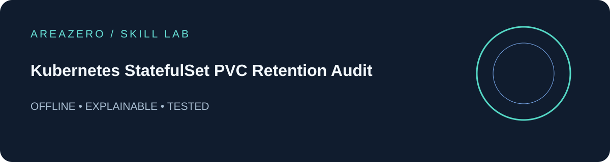

<p align="center"></p>

<p align="center"></p>

# Kubernetes StatefulSet PVC Retention Audit

**Review Kubernetes StatefulSet volumeClaimTemplates and persistentVolumeClaimRetentionPolicy for PVC deletion on scale-down or set removal, malformed policies and missing storage requests. Use before storage-related deployment changes; not a live-cluster audit.** Offline, deterministic, explainable Agent Skill with stable rule IDs and JSON reports.

## Install
```bash
git clone https://github.com/Kanompung1988/k8s-statefulset-pvc-audit.git
cd k8s-statefulset-pvc-audit
python -m pip install -r requirements.txt
python scripts/audit.py examples/safe.yaml --json
python scripts/audit.py examples/review.yaml --json  # intentionally exits 1
python -m unittest discover -s tests -v
```

**Claude Code:** clone this complete repo into `.claude/skills/k8s-statefulset-pvc-audit` in your workspace.

**Codex:** clone this complete repo into `.agents/skills/k8s-statefulset-pvc-audit` in your workspace.

Then ask the agent to follow [SKILL.md](SKILL.md) and run `python scripts/audit.py PATH --json` against a local file you provide.

## CLI and safety
Exit 0 = no findings; 1 = findings; 2 = invalid YAML or input. JSON output has `count` and `findings`. This is **static review**, not a live system test, an exploit detector or a security guarantee. Input YAML is never executed or modified. Symlink root inputs rejected; files limited to 2 MiB.

## Documentation and license
[Rule reference](references/REFERENCE.md) · [Primary sources](references/SOURCES.md) · [MIT code license](LICENSE). The original AREAZERO logo is a separate trademark asset, not licensed for reuse under MIT. Issues and PRs with reproducible fixtures are welcome.
