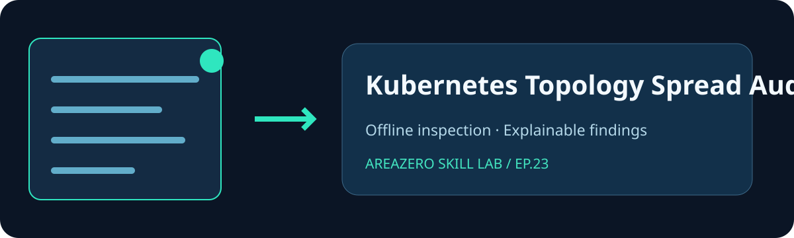

<p align="center"></p>
<p align="center"></p>

# Kubernetes Topology Spread Audit

**Review rollout spread constraints before kube-scheduler placement surprises.**

[](https://github.com/Kanompung1988/k8s-topology-spread-audit/actions/workflows/ci.yml) · Python 3.10+ · MIT code license

## Why this matters

Find risky topologySpreadConstraints: invalid minDomains/maxSkew, missing or mismatched self-selectors, matchLabelKeys conflicts and node inclusion policies. This conservative offline audit gives review evidence; it is not a guarantee of behavior or security in production.

## Quick start

```bash
git clone https://github.com/Kanompung1988/k8s-topology-spread-audit.git
cd k8s-topology-spread-audit
python -m pip install 'PyYAML>=6,<7'
python scripts/audit.py examples/safe.yaml --json       # clean: 0
python scripts/audit.py examples/review.yaml --json     # review: 1
python scripts/audit.py /path/to/project --json         # inspect files recursively
python -m unittest discover -s tests -v
```

Results contain `count` and `findings` with code, severity, file, resource, message and remediation. Exit codes: **0** clear within input scope, **1** review, **2** error. Input files are never modified or uploaded.

## Install for AI agents

- **Claude Code:** `git clone https://github.com/Kanompung1988/k8s-topology-spread-audit.git ~/.claude/skills/k8s-topology-spread-audit`
- **Codex:** `git clone https://github.com/Kanompung1988/k8s-topology-spread-audit.git ~/.agents/skills/k8s-topology-spread-audit`

The skill metadata is in root `SKILL.md`. Clone the full repository so relative scripts and references resolve. Reload skills after installation. Specification: https://agentskills.io/specification.

## Scope and limitations

Kubernetes Pod, Deployment, StatefulSet, DaemonSet, ReplicaSet, Job and CronJob pod templates. No actual node inventory, taints, selector admission, feature-gate behavior or scheduler simulation is performed The audit is an approximation on supplied local documents, not a Helm engine, cluster scheduler, admission controller, or replacement for a production validation. Missing data and unsupported forms may result in missed findings. No secrets should be included in report fixtures. Reports do not echo source YAML values.

Security: YAML uses safe parsing; files must be regular local YAML under a 1 MiB per-file and 100-file bound; no network or child-process execution. The tool will not apply, deploy, fetch dependencies, or resolve live resources.

CI covers Python 3.10/3.12, tests, two CLI examples and frontmatter/brand SVG checks. **Official skills-ref validator: NOT_RUN; independent external review: NOT_DONE.**

[Rules](references/RULES.md) · [Sources](references/SOURCES.md) · [MIT license](LICENSE) · [Contribution guide](CONTRIBUTING.md)

Area Zero brand assets are retained with their original content; trademark rights are not granted by the code license.
