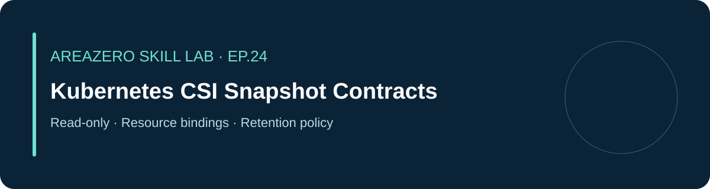

<p align="center"></p>
<p align="center"></p>

# Kubernetes VolumeSnapshot Contract Audit

**A focused, read-only review of CSI snapshot manifest contracts before storage changes.** Unlike a live health check, this never accesses a cluster.

[](https://github.com/Kanompung1988/k8s-volume-snapshot-contract-audit/actions/workflows/ci.yml)

## Install for Claude Code / Codex
Clone `https://github.com/Kanompung1988/k8s-volume-snapshot-contract-audit.git` and put its root in your skills path (`~/.claude/skills/k8s-volume-snapshot-contract-audit` or `~/.agents/skills/k8s-volume-snapshot-contract-audit`). Keep SKILL.md, audit.py, examples, references and assets. Python 3.10+ with `pip install 'PyYAML>=6,<7'`.

## Run
```bash
python audit.py examples/safe.yaml
python audit.py examples/review.yaml --format json
python audit.py examples/review.yaml --strict
python -m unittest discover -s tests -v
```

The safe fixture has no findings and exits 0. The review fixture records Delete policy and absent-in-batch PVC, exits 0 by default or 2 with --strict. Invalid inputs exit 1. Findings carry code/severity/file/object/detail; no data is sent over a network. Each GitHub CI job checks Python 3.10 or 3.12, unit tests, smoke fixtures, Agent Skills frontmatter and SVG parse.

## Interpretation and limitations
A missing name in local YAML may exist in a separate manifest or cluster. CSI drivers, CRDs, controller status, StorageClass driver bindings, live restore readiness and true data retention are outside scope. Delete policies are meaningful risks, not automatically invalid. Static findings cannot prove backup success or durability.

Official sources: [Kubernetes Volume Snapshots](https://kubernetes.io/docs/concepts/storage/volume-snapshots/) · [Snapshot Classes](https://kubernetes.io/docs/concepts/storage/volume-snapshot-classes/) · [Agent Skills spec](https://agentskills.io/specification).

MIT software license; original owner Area Zero logo is excluded. See BRAND.md and CONTRIBUTING.md. [AREAZERO portfolio](https://github.com/Kanompung1988/agent-skills). Skill Lab social OFF; Daily AI Scout unchanged. Official skills-ref validation and independent external review NOT_RUN.
