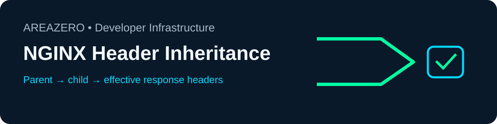

<p align="center"></p>
<p align="center"></p>

# NGINX Header Inheritance Audit

**Stop unintentionally dropping security headers in nested NGINX scopes.** A local `add_header Cache-Control ...` inside a location can silently replace parent security headers under the standard inheritance model. NGINX 1.29.3 added `add_header_inherit merge`; this tool understands that option without claiming server-version autodetection.

[](https://github.com/Kanompung1988/nginx-header-inheritance-audit/actions/workflows/ci.yml) · [Agent Skills Specification](https://agentskills.io/specification) · MIT

## Install (Claude Code / Codex)
Clone this **standalone repository**. Place its root with `SKILL.md` under `.claude/skills/nginx-header-inheritance-audit/` for a project-local Claude Code skill or `.agents/skills/nginx-header-inheritance-audit/` for Codex; keep `scripts/`, `references/` and `examples/` beside it.

```bash
git clone https://github.com/Kanompung1988/nginx-header-inheritance-audit.git
cd nginx-header-inheritance-audit
python scripts/audit.py examples/safe.conf
python scripts/audit.py examples/review.conf --json   # intentionally exits 1
python -m unittest discover -s tests -v
```

Run against an authorized local NGINX config:
```bash
python scripts/audit.py /path/to/nginx.conf --json --nginx-version 1.29.3
```

Exit statuses: **0** no modeled findings, **1** review items, **2** input or parse error. Rule IDs: NGH001 inherited header loss, NGH002 missing `always`, NGH003 unresolved includes, NGH004 invalid inherit mode, NGH005 unsupported version, NGH006 malformed header form.

## Safety, limitations & contribution
Offline Python stdlib only; no configuration is edited or executed, no network access. This is a constrained lexical parser, **not** `nginx -t`: includes are not followed, native module semantics and live responses are not evaluated, and unexpected grammar may be missed. Never commit secrets in reproductions. PRs should add small synthetic fixtures and regression tests. See [rule reference](references/rules.md). Sources: [NGINX module documentation](https://nginx.org/en/docs/http/ngx_http_headers_module.html). See [SKILL.md](SKILL.md) for agent procedure.

Source and scripts are MIT; official Area Zero wordmark remains the trademark holder's asset (not sublicensed). This is an [AREAZERO Skill Lab](https://github.com/Kanompung1988/agent-skills) project. Editorial score **94/100** is internal, not independent verification.
