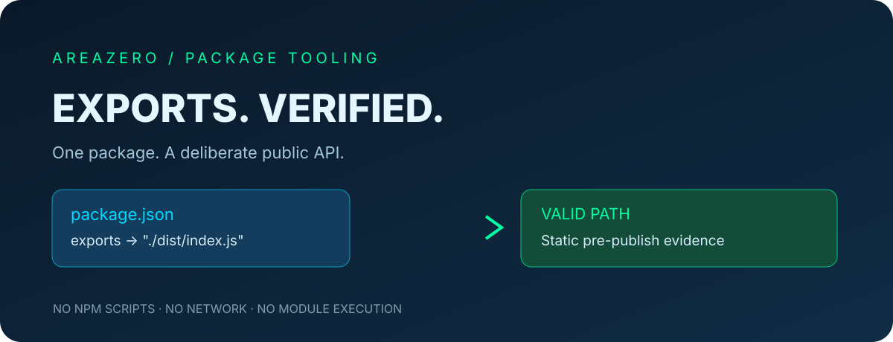

<p align="center"></p>
<p align="center"></p>
<h2 align="center">A broken export map is a broken public API.</h2>
<p align="center">Review Node.js package entrypoints before npm publish — safely, offline, from Claude Code or Codex.</p>
<p align="center"><a href="https://github.com/Kanompung1988/npm-export-map-audit/actions/workflows/ci.yml"></a> &nbsp; <a href="https://agentskills.io/specification">Agent Skills spec</a> · <a href="LICENSE">MIT code</a></p>

## Problem and promise
An npm library can expose `"." : "../internal.js"` or accidentally mix condition keys with package subpaths in its `exports` declaration. Node validates exports targets as relative in-package paths; reviewers need quick, deterministic feedback without executing third-party build scripts.

This Agent Skill reads `package.json` and reports invalid prefixes, unsafe path segments, mixed object keys, unresolved wildcard patterns and optionally missing built files.

## 90-second quickstart
```bash
git clone https://github.com/Kanompung1988/npm-export-map-audit.git
cd npm-export-map-audit
python scripts/audit.py examples/safe --format json
python scripts/audit.py examples/review --format text --fail-on high
python scripts/audit.py /path/to/package --format json --fail-on review
python scripts/audit.py /path/to/built-package --check-files
python -m unittest discover -s tests -v
```
Review fixture: `INVALID_TARGET_PREFIX`; no fixture represents a real package vulnerability. Exit codes 0 = no threshold finding, 1 = detected, 2 = invalid input.

## Claude Code and Codex installation
**Claude Code**
```bash
mkdir -p .claude/skills
git clone https://github.com/Kanompung1988/npm-export-map-audit.git .claude/skills/npm-export-map-audit
```
**Codex**
```bash
mkdir -p .agents/skills
git clone https://github.com/Kanompung1988/npm-export-map-audit.git .agents/skills/npm-export-map-audit
```
The package root contains a portable `SKILL.md` with trigger, procedure and non-trigger rules; Python 3.10+ only, no extra dependencies.

## Findings
| Code | Interpretation |
|---|---|
| `INVALID_TARGET_PREFIX` / `INVALID_TARGET_SEGMENT` | Definite static export path rules issue |
| `MIXED_EXPORT_KEYS` / `INVALID_EXPORT_KEY` | Shape or key path issue |
| `INVALID_TARGET_TYPE` | Unhandled export value structure |
| `PATTERN_UNRESOLVED` | Requires package-file expansion and Node behavior check |
| `TARGET_NOT_PRESENT` | Only when `--check-files` is used on expected built output |

## Boundaries
- Does not run `npm`, Node.js, JavaScript, TypeScript or lifecycle scripts.
- Reads only one local JSON manifest (up to 2 MB), rejects duplicate JSON keys and symlinks, and optionally checks **path existence**.
- Conditional exports priority and pattern expansion depend on Node resolution. The static result is **not** proof that `import` or `require` works across Node versions or bundlers.
- Missing distribution files are common before builds; `--check-files` should be used only when those outputs are expected to exist. No network operations.
- For release readiness, also run Node runtime import checks and `npm pack --dry-run` in a trusted environment.

## Repository map and attribution
`SKILL.md` · `scripts/audit.py` · `tests/test_audit.py` · `examples/safe/package.json` · `examples/review/package.json` · `references/MODEL.md` · `assets/hero.svg` · `assets/area-zero-logo-full.svg`.

See [CONTRIBUTING.md](CONTRIBUTING.md), [SECURITY.md](SECURITY.md) and [references/MODEL.md](references/MODEL.md). The implementation is MIT-licensed. The original Area Zero logo is excluded from MIT and remains the owner's artwork.

## Primary references
- https://nodejs.org/api/packages.html#path-rules-and-validation-for-export-targets
- https://docs.npmjs.com/cli/v11/configuring-npm/package-json/#exports
- https://agentskills.io/specification
