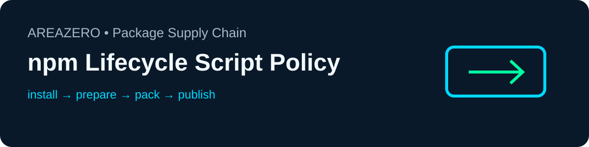

<p align="center"></p>
<p align="center"></p>

# npm Lifecycle Script Policy Audit

**Know what npm may run before you invoke install or packaging.** A clean `npm ci` command does not imply scripts won't run; `prepare`, `preinstall` and legacy `prepublish` each have distinct lifecycle implications. This stdlib Python checker maps the hooks in a **single supplied** `package.json` and notes implicit `binding.gyp` rebuilds without running any npm code.

[](https://github.com/Kanompung1988/npm-lifecycle-policy-audit/actions/workflows/ci.yml) · [Agent Skills Specification](https://agentskills.io/specification) · MIT

## Installation — Claude Code / Codex
Clone the standalone repository and place it under your project-local `.claude/skills/npm-lifecycle-policy-audit/` (Claude Code) or `.agents/skills/npm-lifecycle-policy-audit/` (Codex). Keep `SKILL.md` and `scripts/` at the same directory root. Python >=3.10 is sufficient; no `npm install` is needed.

```bash
git clone https://github.com/Kanompung1988/npm-lifecycle-policy-audit.git
cd npm-lifecycle-policy-audit
python -m unittest discover -s tests -v
python scripts/audit.py examples/safe/
python scripts/audit.py examples/review/ --json  # intentionally exits 1
```

Review a package before executing npm:
```bash
python scripts/audit.py /path/to/package.json --json
python scripts/audit.py /path/to/package.json --allow prepare
```

Return codes **0** = no modeled findings; **1** = hooks to review; **2** = invalid input. `--allow` filters reviewed hooks only; it does not change npm's actual behavior.

## Coverage and boundaries
NPM001 install/ci hooks, NPM002 pack/publish hooks, NPM003 node_modules mutation hook, NPM004 `binding.gyp` default compile, NPM005 invalid values, NPM006 legacy prepublish. Rule descriptions and version notes: [references/rules.md](references/rules.md).

No network, installs, script invocation, or rewriting. Scans only one local manifest; does not parse every package in a workspace or dependency tree, flag arbitrary shell command risk, or prove script safety. Findings contain only rule name and hook name, **never script bodies**, to reduce credential leakage. All examples are synthetic. Contributions welcome as small safe fixtures + tests.

Sources: [npm scripts documentation](https://docs.npmjs.com/cli/v11/using-npm/scripts/). MIT software license excludes official Area Zero brand mark, which remains its owner's asset. Published by [AREAZERO Skill Lab](https://github.com/Kanompung1988/agent-skills). Editorial score **92/100** is an internal judgment, not an external rating.
