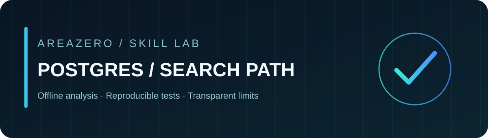

<p align="center"></p>
<p align="center"></p>

# PostgreSQL SECURITY DEFINER Path Audit

**Review privileged routine search paths before applying migrations.** A small offline Agent Skill for SQL migration pull requests. Never connects to PostgreSQL or runs statements.

[](https://github.com/Kanompung1988/pg-security-definer-path-audit/actions/workflows/ci.yml) · [Agent Skills specification](https://agentskills.io/specification) · MIT

## What it checks

- `CREATE FUNCTION` / `CREATE PROCEDURE` using `SECURITY DEFINER` without routine-level `SET search_path`.
- Explicit `pg_temp` omission or ordering, `public`/`$user` review, and unresolved `search_path`.
- Masks comments, SQL string literals, tagged dollar-quoted bodies, and supports nested `/* */` comments to reduce false positives.

## Quick start

```bash
git clone https://github.com/Kanompung1988/pg-security-definer-path-audit.git
cd pg-security-definer-path-audit
python scripts/audit.py fixtures/safe.sql --strict
python scripts/audit.py fixtures/review.sql --format json --strict  # exits 2 on findings
python -m unittest discover -s tests -v
```

Exit codes: `0` successful analysis with no findings (or non-strict report); `1` unreadable input; `2` findings with `--strict`.

### Claude Code

Clone into `.claude/skills/pg-security-definer-path-audit` under your project, or your user skills directory. Let the agent read root `SKILL.md` before using the analyzer.

### Codex

Clone into `.agents/skills/pg-security-definer-path-audit` under a project or `$HOME/.agents/skills/pg-security-definer-path-audit`. The CLI only reads requested SQL files.

### Safety and limitations

**Not a database privilege audit** or full SQL parser. Complex grammar and `ALTER FUNCTION` changes are outside scope. A safe-looking search path is not proof that the named schemas are trusted. Review schema ACLs, ownership and default `PUBLIC` EXECUTE permissions manually. See [PostgreSQL guidance](https://www.postgresql.org/docs/current/sql-createfunction.html) and [reference](references/REFERENCE.md).

Please see [CONTRIBUTING.md](CONTRIBUTING.md). Code under MIT; original AREAZERO logo retained separately. No production safety certification is claimed.
