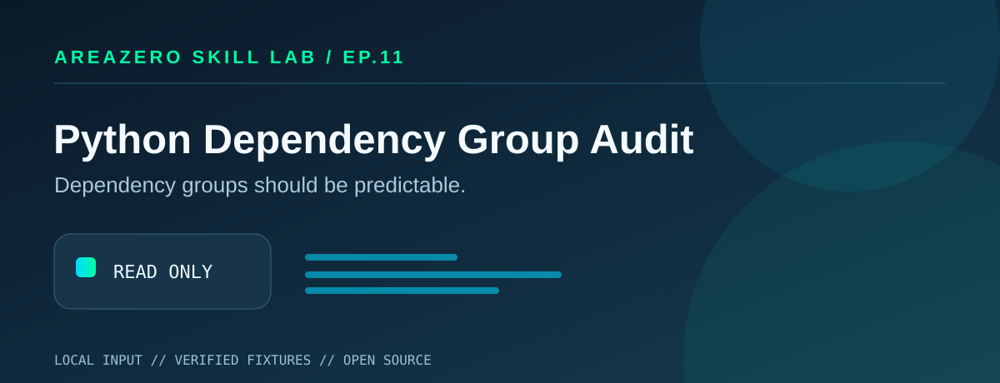

<p align="center"></p>
<p align="center"></p>

# Python Dependency Group Audit

**Dependency groups should be predictable.** PEP 735 development groups are often copied between projects without checking normalization collisions, invalid PEP 508 specifiers or recursive include-group cycles.

[](https://github.com/Kanompung1988/py-dependency-group-audit/actions/workflows/ci.yml) [](https://agentskills.io/specification) 

## Why this exists
A focused read-only review tool with stable rule IDs, simple local CLI usage, synthetic fixtures, structured JSON output and honest boundaries. It does not phone home or modify the input. This is static analysis, not a certificate of production safety.

## Installation — Claude Code and Codex
Clone this **standalone repository**; install it under a supported skills folder for the relevant agent, such as project-local `.claude/skills/py-dependency-group-audit/` for Claude Code or `.agents/skills/py-dependency-group-audit/` for Codex. Keep `SKILL.md` at the top of the cloned directory and review scripts before running them.

```bash
git clone https://github.com/Kanompung1988/py-dependency-group-audit.git
cd py-dependency-group-audit
python -m pip install -r requirements.txt
```

Python 3.10+; run `pip install -r requirements.txt` for packaging and Python 3.10's tomli.

## Quickstart and reproducible examples
```bash
python scripts/audit.py examples/safe.toml
python scripts/audit.py examples/review.toml --json
python -m unittest discover -s tests -v
```

Expected safe output:
```text
0 finding(s)
```

The **review** example intentionally returns exit code `1` and structured JSON `count > 0`. Exit code `2` means unreadable, overlarge or malformed input. All fixtures contain synthetic data.

Prompt your agent: *Use `py-dependency-group-audit` to review this locally provided file, cite rule IDs and suggest minimal fixes. Do not make changes and do not assume production state.*

## Rules
Normalized names (PEP 503 style), strict list values, valid PEP 508 requirements using PyPA packaging, include-group object shape, normalized target lookup and acyclic include graphs.

## Repository layout
| File | Responsibility |
|---|---|
| `SKILL.md` | Agent Skills specification frontmatter, triggers and procedure |
| `scripts/audit.py` | Deterministic local read-only audit engine |
| `tests/test_audit.py` | Regression and boundary tests |
| `examples/` | Clean and intentionally problematic synthetic fixtures |
| `references/rules.md` | Precise coverage and cited technical references |
| `.github/workflows/ci.yml` | Matrix tests on Python 3.10 and 3.12 |
| `assets/` | Original SVG hero and exact owner-supplied Area Zero wordmark |

## Security and limitations
Does not install packages, resolve versions, inspect package registries, install from requirements files, or compare lockfiles. Invalid input values are not echoed, since dependency URLs can contain credentials. A clean report does not establish compatible dependencies. Inputs over 2 MB are rejected to avoid accidental bulk processing. Do not publish real secrets in GitHub issues; redact all reproduction inputs. The CLI does not execute inspected input. No production account is required. Code is released for review and improvement, not third-party security endorsement.

## Sources
1. https://packaging.python.org/en/latest/specifications/dependency-groups/
2. https://peps.python.org/pep-0735/
3. https://packaging.pypa.io/en/stable/requirements.html

## Contributing, license, attribution
File issues with safe synthetic reproduction cases. Run unit tests and CLI fixtures before opening a PR. Code is MIT licensed. The **official Area Zero logo** is an unmodified owner-owned brand asset and is not relicensed under MIT. The hero artwork was created specifically for this skill.

Part of the [AREAZERO Skill Lab](https://github.com/Kanompung1988/agent-skills). Internal editorial review score **94/100** is not an external rating or adoption metric.
