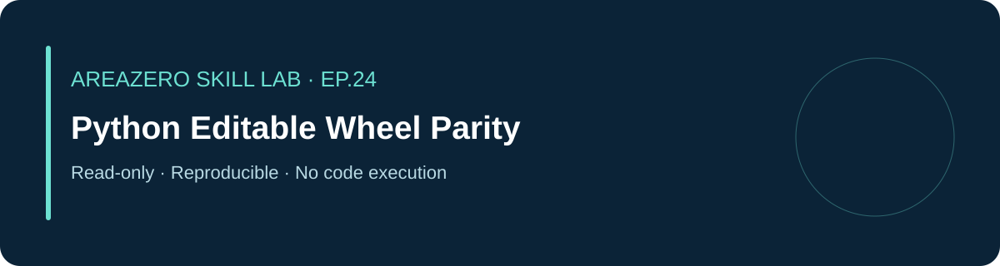

<p align="center"></p>
<p align="center"></p>

# Python Editable Wheel Metadata Parity Audit

**Know when a regular wheel and editable wheel disagree before release.** Offline static analysis; never execute untrusted wheel code.

[](https://github.com/Kanompung1988/py-editable-wheel-parity-audit/actions/workflows/ci.yml) · [Agent Skills spec](https://agentskills.io/specification)

## Install into Claude Code / Codex
Clone `https://github.com/Kanompung1988/py-editable-wheel-parity-audit` and place its root directory in your configured Agent Skills location, e.g. `~/.claude/skills/py-editable-wheel-parity-audit` or `~/.agents/skills/py-editable-wheel-parity-audit`. The skill is also executable as ordinary Python 3.10+. Preserve the root SKILL.md and script.

## Run
```bash
python audit.py normal.whl editable.whl --format json --strict
python audit.py normal.whl editable.whl --allow-extra editables
python -m unittest discover -s tests -v
python tests/cli_smoke.py
```

Normal output is text; JSON is stable machine-readable findings. Exit 0=no errors, 1=bad input, 2=errors (review counts in --strict). CI tests Python 3.10 and 3.12, frontmatter, SVG validity and CLI smoke. Do not claim CI success until GitHub verifies the exact commit.

## Limits and safety
PEP 660 permits extra editable-only mechanism dependencies, which require manual justification. Textual Requires-Dist comparison may flag syntactically equivalent dependency expressions. WHEEL tags may differ; RECORD, source imports, build isolation and editable runtime behavior are deliberately not compared. No wheel is installed, distributed or extracted. Only synthetic throwaway editable wheels appear in tests. Official skills-ref validation and external review not claimed.

## Sources and license
[PEP 660](https://peps.python.org/pep-0660/) · [Wheel format](https://packaging.python.org/en/latest/specifications/binary-distribution-format/) · [Core metadata](https://packaging.python.org/en/latest/specifications/core-metadata/).

MIT code license. Original Area Zero logo is not covered by MIT; see BRAND.md. [Skill Lab portfolio](https://github.com/Kanompung1988/agent-skills). Skill Lab Social OFF; Daily AI Scout unchanged.
